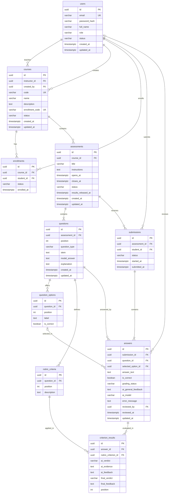

# Evaluador Virtual de Academia

## Descripción General 

El Evaluador Virtual de Academia es una aplicación web orientada a instituciones educativas y centros de preparación que busca automatizar la calificación de evaluaciones con preguntas abiertas — aquellas cuya respuesta no es exacta ni cerrada y que tradicionalmente dependen del criterio subjetivo del docente.

A diferencia de un corrector de respuestas cerradas (opción múltiple, verdadero/falso), el sistema debe interpretar la intención del alumno al responder, identificar los conceptos clave presentes en su texto y contrastarlos semánticamente contra los puntos esperados de la respuesta modelo, devolviendo un porcentaje de acierto y, cuando corresponda, retroalimentación orientada a la mejora.

## Problema que resuelve

La corrección manual de preguntas abiertas es lenta, inconsistente entre distintos correctores y difícil de escalar cuando el volumen de alumnos crece (exámenes de admisión, simulacros, prácticas calificadas). Esto genera demoras en la entrega de resultados y limita la frecuencia con la que un alumno recibe feedback formativo sobre su razonamiento, no solo sobre si "acertó o no".

## Propuesta de valor
- Reduce el tiempo de corrección de preguntas abiertas de horas/días a minutos.
- Estandariza el criterio de evaluación entre secciones y docentes, al basarse en los mismos puntos clave definidos por pregunta.

- Da feedback accionable al alumno (no solo una nota), fomentando la mejora continua en simulacros previos a un examen real.

- Escala sin necesidad de contratar más correctores conforme crece el número de evaluados.

## MVP (ajustado)

El MVP consiste en una aplicación web donde:

1. El docente registra una evaluación: crea preguntas abiertas y define, para cada una, los puntos clave o criterios esperados de respuesta (una rúbrica base en texto que alimentará al modelo).
2. El alumno responde las preguntas desde la misma plataforma.
3. El motor de ML/LLM procesa cada respuesta: identifica el texto, comprende el contexto de la pregunta y extrae las palabras clave y datos relevantes presentes en ella.
4. El sistema compara lo extraído contra los criterios definidos por el docente y devuelve un resultado cualitativo (por ejemplo: "cumple", "cumple parcialmente", "no cumple" por cada criterio esperado), junto con una observación breve de qué le faltó a la respuesta. Aún no se calcula un porcentaje de acierto — esa cuantificación queda para una siguiente iteración, una vez validado que el modelo identifica bien los conceptos clave.

### Quedan fuera del MVP (mejoras futuras, en orden de prioridad hacia la visión final del producto):

Cálculo de porcentaje de acierto por respuesta, una vez calibrado el criterio cualitativo.
Detección y calificación de imágenes o diagramas dentro de la respuesta del alumno.
Comparación entre respuestas de distintos alumnos para detectar plagio.
Dashboard analítico de desempeño por curso/sección.
Ajuste fino del modelo con feedback histórico de los propios docentes.

## Capas de la Aplicación

### Frontend

Interfaz web para dos roles: docente (creación y gestión de evaluaciones, definición de criterios por pregunta, revisión de lo que calificó la IA y publicación de resultados) y alumno (rendir la evaluación y ver su veredicto por criterio y feedback una vez publicados los resultados).

### Backend

Spring Boot con DDD + arquitectura hexagonal. Gestiona la persistencia de evaluaciones, preguntas, criterios de corrección y respuestas de alumnos; orquesta el envío de cada respuesta al servicio de IA y almacena el resultado (veredicto por criterio + feedback) asociado a cada intento.

### LLM o ML

Microservicio Python (`SystemAcademy_AI`, FastAPI) que recibe la pregunta, la respuesta modelo, los criterios esperados y la respuesta del alumno; le pide al LLM un veredicto por criterio (`MEETS` / `PARTIALLY_MEETS` / `DOES_NOT_MEET`) con evidencia y feedback, valida que la respuesta cumpla el contrato y la devuelve al backend.

## Modelo de Datos




Notas del modelo:
- `submissions` tiene una restricción única (`assessment_id`, `student_id`): un alumno rinde cada evaluación una sola vez.
- `criterion_results.position` guarda el orden del criterio en la rúbrica, para devolver los resultados siempre en el mismo orden.
- `assessments.results_released_at` marca cuándo el docente publicó los resultados (null = no publicados).
- `question_options`, `answers.selected_option_id` y `answers.is_correct` siguen sin usarse: el MVP solo contempla preguntas abiertas.

## Estado actual (actualizado al 6 de octubre de 2026)

El flujo completo del MVP está implementado y probado de punta a punta con Gemini real.

### Flujo implementado

1. Un usuario se registra y se autentica (`users`), queda identificado por rol.
2. Un docente crea un curso (`courses`) y recibe un código de matrícula; un alumno se une con ese código (`enrollments`).
3. El docente arma una evaluación (`assessments`): preguntas abiertas (`questions`), respuesta modelo y criterios de corrección (`rubric_criteria`). La publica con una ventana de tiempo (`opens_at` / `closes_at`).
4. El alumno inicia la evaluación (`submissions`), responde cada pregunta (`answers`) y entrega.
5. **Al entregar, la IA califica automáticamente cada respuesta en segundo plano**: por cada criterio deja un veredicto con evidencia y feedback (`criterion_results`), más un feedback general.
6. El docente revisa los resultados y puede corregir cualquier veredicto. Se guarda el veredicto original de la IA (`ai_verdict`) y el que vale (`final_verdict`), y queda registrado quién revisó (`reviewed_by` / `reviewed_at`).
7. Cuando la evaluación cerró y todas las respuestas están calificadas, el docente **publica los resultados** (`results_released_at`).
8. Recién ahí el alumno ve su resultado: solo el veredicto final y el feedback, nunca el veredicto original de la IA ni datos internos.

### Reglas de negocio

| Regla | Respuesta si no se cumple |
|---|---|
| Solo un alumno matriculado en el curso puede rendir | 403 |
| Solo se inicia, responde o entrega dentro de la ventana de la evaluación publicada | 422 |
| Un solo intento por alumno y evaluación | 409 |
| La pregunta respondida debe pertenecer a esa evaluación | 400 |
| Solo el docente dueño del curso califica, revisa, lista entregas y publica | 403 |
| Se publica solo con la evaluación cerrada y sin respuestas pendientes de calificar | 422 |
| Los resultados se publican una sola vez | 422 |
| La respuesta modelo nunca se envía al alumno | — |
| Una respuesta que falló al calificarse (`FAILED`) se puede reintentar; una ya calificada no se recalifica | 422 |

### Integración con IA

En vez de Spring AI, la IA quedó como un **microservicio Python independiente** (`SystemAcademy_AI`). El backend lo llama por HTTP a través del puerto `GradingEngine`:

- `grading.engine=mock`: motor simulado, para desarrollo sin costo.
- `grading.engine=http`: llama a `POST /api/v1/grade` del servicio de IA.

El servicio de IA soporta varios proveedores cambiando solo variables de entorno: `mock`, `openai_compat` (Gemini, Groq, Ollama u OpenAI) y `anthropic`. Hoy se usa **Gemini** con `gemini-3.5-flash-lite` (plan gratis). Los modelos Flash más grandes estaban respondiendo 503 por alta demanda; cuando se normalicen se puede cambiar el modelo sin tocar código.

Decisiones de diseño:
- **Calificación asíncrona:** al entregar se publica el evento de dominio `SubmissionSubmittedEvent`; un handler califica cada respuesta en un pool de hilos acotado (`grading.async.pool-size`, por defecto 2) para no superar la cuota del proveedor. El alumno no espera a la IA.
- **Tiempos:** el servicio de IA tiene un presupuesto total de 80 s sumando todos sus intentos (`GRADING_BUDGET_SECONDS`), menor que el timeout del backend (90 s). Así el backend nunca corta una llamada que la IA sigue procesando.
- **Fallos:** si la IA falla, la respuesta queda `FAILED` y el docente la reintenta. Una respuesta fallida no frena a las demás.
- **Contrato validado:** el servicio de IA verifica que el modelo devuelva exactamente un veredicto por cada criterio enviado; si no, reintenta y, si sigue mal, responde 502.
- **Contextos desacoplados:** `submissions` consulta a `assessments` y `courses` por puertos (`AssessmentAccessProvider`); `assessments` pregunta cuánto falta calificar por un puerto que implementa `submissions` (`GradingProgressService`), así la dependencia entre contextos va en una sola dirección.

### Calidad y CI

- 49 tests: dominio, casos de uso, visibilidad de resultados, persistencia y 5 reglas de arquitectura con ArchUnit (el dominio no usa frameworks, los casos de uso no dependen de adaptadores, los controllers no usan repositorios, solo inyección por constructor, logs en vez de `System.out`).
- CI en GitHub Actions (gratis) en cada push y PR a `develop` y `main`: build, tests con Postgres real, cobertura con JaCoCo (solo reporte; hoy 47% de líneas) y búsqueda de secretos con Gitleaks. Dependabot propone actualizaciones de dependencias cada semana.
- Logs con IDs (`submissionId`, `answerId`, `questionId`, `assessmentId`) en ambos servicios para seguir cada calificación de punta a punta.

### Pendiente

- Reintentar en lote las respuestas `FAILED` (hoy se reintentan una por una).
- Si el backend se reinicia con calificaciones en cola, esas respuestas quedan `PENDING` hasta que el docente las reintente.
- Subir la cobertura de `identity` y `courses` y fijar un mínimo de cobertura en el CI.
- Endurecer el servicio de IA: comparar la API key en tiempo constante, limitar el largo de la respuesta, escapar el delimitador del prompt y no reintentar ante errores 4xx.
- Producción: secretos propios (JWT, API key entre servicios) y un plan de Gemini con facturación, porque el plan gratis puede usar los datos enviados para mejorar los productos de Google.

## Guía para frontend: calificación y resultados

Todos los endpoints están documentados en `http://localhost:8080/scalar`.

### Cómo funciona el flujo

```
Alumno entrega ──► la IA califica sola (segundo plano, ~2-15 s por respuesta)
                        │
Docente ve resultados ◄─┘  (puede corregir veredictos)
                        │
Evaluación cierra (closesAt) ──► Docente pulsa "Publicar resultados"
                        │
Alumno ve su resultado ◄┘  (antes de publicar no ve nada de la calificación)
```

- No hay botón "calificar con IA" en el flujo normal: se califica automáticamente al entregar.
- La acción nueva del docente es el botón "Publicar resultados".

### Endpoints

| Quién | Método y ruta | Para qué |
|---|---|---|
| Docente | `GET /api/v1/assessments/{assessmentId}/submissions` | Ver entregas con la calificación completa de la IA |
| Docente | `PUT /api/v1/submissions/{submissionId}/answers/{answerId}/criteria/{criterionResultId}` | Corregir un veredicto. Body: `{"finalVerdict":"PARTIALLY_MEETS","finalFeedback":"texto opcional"}` |
| Docente | `POST /api/v1/submissions/{submissionId}/answers/{answerId}/grade` | Solo para reintentar una respuesta en `FAILED` (sin body) |
| Docente | `POST /api/v1/assessments/{assessmentId}/result-releases` | Publicar resultados (sin body) |
| Alumno | `GET /api/v1/submissions/{submissionId}` | Ver su entrega |
| Alumno | `GET /api/v1/students/me/submissions` | Listar sus entregas |

Veredictos posibles: `MEETS` (cumple), `PARTIALLY_MEETS` (cumple parcialmente), `DOES_NOT_MEET` (no cumple).

### Vista del docente

Estado de calificación de cada respuesta (`gradingStatus`):

| Valor | Mostrar |
|---|---|
| `PENDING` / `PROCESSING` | "Calificando…" y refrescar la lista cada 3-5 s |
| `COMPLETED` | Los veredictos |
| `FAILED` | "Error al calificar" y un botón "Reintentar" (llama a `/grade`) |

Respuesta de `GET /assessments/{id}/submissions` (el docente ve todo):

```json
[{
  "id": "…", "assessmentId": "…", "studentId": "…", "status": "SUBMITTED",
  "answers": [{
    "id": "…", "questionId": "…", "answerText": "Oculta el estado…",
    "gradingStatus": "COMPLETED",
    "aiGeneralFeedback": "Buen entendimiento… faltó el acoplamiento.",
    "aiModel": "gemini-3.5-flash-lite",
    "errorMessage": null,
    "reviewedBy": "uuid-del-docente o null",
    "criterionResults": [{
      "id": "…", "rubricCriterionId": "…",
      "aiVerdict": "MEETS", "aiEvidence": "…", "aiFeedback": "…",
      "finalVerdict": "PARTIALLY_MEETS", "finalFeedback": "corregido por el docente"
    }]
  }]
}]
```

- `aiVerdict` es lo que dijo la IA y nunca cambia. `finalVerdict` es lo que vale: igual al de la IA hasta que el docente lo corrige.
- `criterionResults` viene en el orden de la rúbrica. Para mostrar el texto de cada criterio, emparejar por `rubricCriterionId` con `GET /assessments/{id}` → `questions[].criteria[]`.
- Si `reviewedBy` no es null, mostrar "Revisado por docente".

Botón "Publicar resultados": habilitarlo cuando la evaluación ya cerró (`closesAt` pasado) y `resultsReleasedAt` es null. `GET /assessments/{id}` incluye `resultsReleasedAt`.

| Respuesta | Mensaje sugerido |
|---|---|
| 200 con `resultsReleasedAt` | "Resultados publicados" |
| 422 `quedan N respuestas sin calificar` | Mostrar el mensaje y revisar las `FAILED` |
| 422 `solo se publican resultados de una evaluación ya cerrada` | "Esperá a que cierre la evaluación" |
| 422 `los resultados ya fueron publicados` | Deshabilitar el botón |
| 403 | No es su curso |

### Vista del alumno

Usa los mismos endpoints, pero el contenido depende de si los resultados se publicaron.

Antes de publicar, solo sus respuestas, sin nada de calificación. Mostrar "Resultados aún no publicados":

```json
{ "answers": [{ "id": "…", "questionId": "…", "answerText": "…",
  "gradingStatus": null, "aiGeneralFeedback": null, "criterionResults": [] }] }
```

Después de publicar, solo el resultado final. Usar siempre `finalVerdict` y `finalFeedback`:

```json
{ "answers": [{ "answerText": "…", "gradingStatus": "COMPLETED",
  "aiGeneralFeedback": "Buen entendimiento…",
  "aiModel": null, "errorMessage": null, "reviewedBy": null,
  "criterionResults": [{ "rubricCriterionId": "…",
    "aiVerdict": null, "aiFeedback": null, "aiEvidence": "…",
    "finalVerdict": "PARTIALLY_MEETS", "finalFeedback": "…" }] }] }
```

### Cambios respecto a lo que ya existía

Revisar si el frontend ya usaba alguno de estos comportamientos:

| Antes | Ahora |
|---|---|
| El alumno veía los veredictos de la IA apenas se calificaba | Solo después de publicar, y solo `finalVerdict` / `finalFeedback` |
| Calificar era manual (`/grade` por respuesta) y cualquiera podía llamarlo | Automático al entregar; `/grade` solo para el docente dueño y solo para `FAILED` (una `COMPLETED` da 422) |
| Un alumno podía iniciar cualquier evaluación, varias veces | Solo si está matriculado (403), con la evaluación abierta (422) y una vez (409) |
| Se podía responder o entregar con la evaluación cerrada | 422 `la evaluación no está abierta para rendir` |
| Se aceptaba cualquier `questionId` | 400 si la pregunta no es de esa evaluación |
| "No sos el dueño" (curso, entrega, evaluación) respondía 422 | Ahora 403. Afecta también crear evaluación, agregar pregunta y publicar evaluación |
| Un docente listaba entregas de cualquier evaluación | Solo las de sus cursos; si no, lista vacía |
| JSON mal formado respondía 500 | 400 |
| — | Nuevo: `resultsReleasedAt` en la evaluación y `POST /assessments/{id}/result-releases` |
