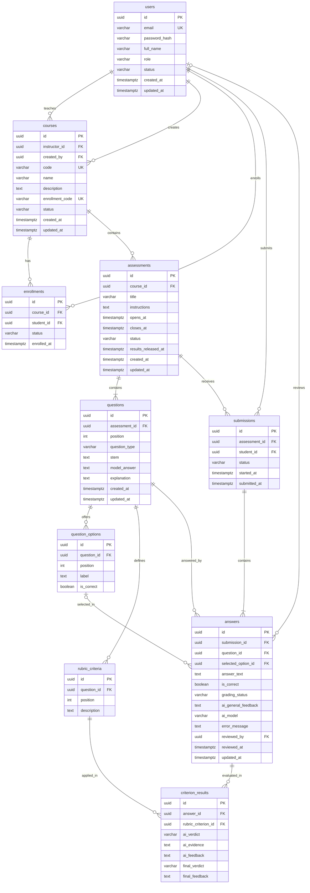

# Evaluador Virtual de Academia

## Descripción General 

El Evaluador Virtual de Academia es una aplicación web orientada a instituciones educativas y centros de preparación que busca automatizar la calificación de evaluaciones con preguntas abiertas — aquellas cuya respuesta no es exacta ni cerrada y que tradicionalmente dependen del criterio subjetivo del docente.

A diferencia de un corrector de respuestas cerradas (opción múltiple, verdadero/falso), el sistema debe interpretar la intención del alumno al responder, identificar los conceptos clave presentes en su texto y contrastarlos semánticamente contra los puntos esperados de la respuesta modelo, devolviendo un porcentaje de acierto y, cuando corresponda, retroalimentación orientada a la mejora.

## Problema que resuelve

La corrección manual de preguntas abiertas es lenta, inconsistente entre distintos correctores y difícil de escalar cuando el volumen de alumnos crece (exámenes de admisión, simulacros, prácticas calificadas). Esto genera demoras en la entrega de resultados y limita la frecuencia con la que un alumno recibe feedback formativo sobre su razonamiento, no solo sobre si "acertó o no".

## Propuesta de valor
- Reduce el tiempo de corrección de preguntas abiertas de horas/días a minutos.
- Estandariza el criterio de evaluación entre secciones y docentes, al basarse en los mismos puntos clave definidos por pregunta.

- Da feedback accionable al alumno (no solo una nota), fomentando la mejora continua en simulacros previos a un examen real.

- Escala sin necesidad de contratar más correctores conforme crece el número de evaluados.

## MVP (ajustado)

El MVP consiste en una aplicación web donde:

1. El docente registra una evaluación: crea preguntas abiertas y define, para cada una, los puntos clave o criterios esperados de respuesta (una rúbrica base en texto que alimentará al modelo).
2. El alumno responde las preguntas desde la misma plataforma.
3. El motor de ML/LLM procesa cada respuesta: identifica el texto, comprende el contexto de la pregunta y extrae las palabras clave y datos relevantes presentes en ella.
4. El sistema compara lo extraído contra los criterios definidos por el docente y devuelve un resultado cualitativo (por ejemplo: "cumple", "cumple parcialmente", "no cumple" por cada criterio esperado), junto con una observación breve de qué le faltó a la respuesta. Aún no se calcula un porcentaje de acierto — esa cuantificación queda para una siguiente iteración, una vez validado que el modelo identifica bien los conceptos clave.

### Quedan fuera del MVP (mejoras futuras, en orden de prioridad hacia la visión final del producto):

Cálculo de porcentaje de acierto por respuesta, una vez calibrado el criterio cualitativo.
Detección y calificación de imágenes o diagramas dentro de la respuesta del alumno.
Comparación entre respuestas de distintos alumnos para detectar plagio.
Dashboard analítico de desempeño por curso/sección.
Ajuste fino del modelo con feedback histórico de los propios docentes.

## Capas de la Aplicación

### Frontend

Interfaz web para dos roles: docente (creación y gestión de evaluaciones, definición de criterios por pregunta, visualización de resultados agregados) y alumno (rendir la evaluación, ver su porcentaje y feedback una vez corregida).

### Backend

Gestiona la persistencia de evaluaciones, preguntas, criterios de corrección y respuestas de alumnos; orquesta el envío de cada respuesta al motor de ML/LLM y almacena el resultado (porcentaje + feedback) asociado a cada intento.

### LLM o ML

Núcleo de procesamiento de lenguaje natural: recibe la pregunta, los criterios esperados y la respuesta del alumno; realiza comprensión semántica y extracción de conceptos clave; calcula el grado de coincidencia con lo esperado y redacta el feedback cuando el acierto es menor a 80%.

## Modelo de Datos

